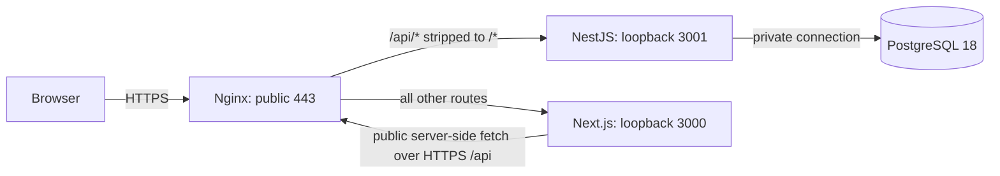

# Production Deployment Setup V1

Date: 2026-09-09. Provider-neutral preparation; no public deployment, DNS change, certificate purchase or cloud resource creation.

## Architecture and trust boundaries

Recommended: one Linux host with Nginx terminating HTTPS, separate systemd services for Next.js and NestJS, and PostgreSQL on loopback or a restricted private network. No container platform or PM2 is required for V1.



Only the proxy is internet-facing. Protect Node ports from direct remote access and never expose PostgreSQL publicly. The proxy overwrites forwarded headers; the backend trusts only loopback when explicitly configured. A local process is therefore inside that proxy trust boundary. Do not reuse this configuration unchanged with a remote load balancer or another proxy chain.

Backend routes have **no global `/api` prefix**. `https://YOUR_DOMAIN/api/products` forwards to `http://127.0.0.1:3001/products`. Next.js owns `/products`; there is no route conflict. The trailing slash in the API `proxy_pass` performs the prefix removal. See the [Nginx proxy_pass documentation](https://nginx.org/en/docs/http/ngx_http_proxy_module.html#proxy_pass).

Required infrastructure: an approved host, maintained/pinned Node and npm versions, PostgreSQL 18, private database credentials, a domain, valid TLS certificate with renewal, service account, firewall, log retention and protected off-host backup destination. Local verification used Node 26.8.1; qualify the exact server runtime in staging rather than silently changing its major version. Do not copy Windows `node_modules` onto Linux: install from lockfiles on the target platform.

## Environment separation

Templates: `backend/.env.example`, `frontend/.env.example`. They contain no credentials. Local `.env` files remain ignored. On production, use private files outside the release, for example an operator-selected `/etc/...` directory readable only by the service account/root, or a secret manager injecting process variables. Do not copy development `.env` files into a release.

| Backend variable | Production value/rule |
| --- | --- |
| `NODE_ENV` | `production` |
| `DATABASE_URL` | Dedicated runtime PostgreSQL URL; private host, correct database and strong credential. URL-encode special credential characters; configure verified TLS for a remote private database. Never print it in deployment logs. |
| `AUTH_SECRET` | Persistent cryptographically generated secret: generate 32 random bytes encoded as hex. Existing validator requires at least 32 bytes and rejects obvious weak/example values. Rotate deliberately; changing it invalidates sessions. |
| `FRONTEND_ORIGIN` | Exact `https://YOUR_DOMAIN`, with no path or trailing slash. Replace the placeholder. |
| `HOST` | `127.0.0.1` for the supplied same-host proxy; also the new default. |
| `PORT` | `3001`; integer 1–65535. |
| `TRUST_PROXY` | `loopback` only behind the supplied local proxy; unset/`false` for direct development. Other values, including `true` and numeric hop counts, are rejected. |
| `COOKIE_SECURE` | Optional assertion, not an override. Omit it or set `true` in production. `false` cannot weaken production cookies. Development uses non-Secure cookies and must not set this to true. |
| `AUTH_SESSION_HOURS` | Optional; default 8, permitted range 0.05–168. |

Production startup validates configuration before importing application/database providers. Missing DATABASE_URL, AUTH_SECRET or FRONTEND_ORIGIN, weak secrets, non-HTTPS origins, invalid proxy settings, invalid ports and an insecure cookie override fail clearly. No production fallback was added.

Frontend configuration contains **public values only**:

```dotenv
NEXT_PUBLIC_API_BASE_URL=https://YOUR_DOMAIN/api
```

Replace YOUR_DOMAIN before building. `src/lib/api-base.ts` is the only runtime API-base definition, shared by browser and server fetches. Development defaults to `http://localhost:3001`. Existing `NEXT_PUBLIC_API_URL` remains a compatibility alias; the new name takes precedence. Use one name consistently. Absolute HTTPS origins, optionally ending in `/api`, are supported; HTTP is accepted only for loopback development. Credentials, query strings and fragments in the base are rejected.

This variable is embedded at **build time**; changing only a service's environment will not update browser bundles. Build and start with the same value. Server-side public-product fetching also uses this URL, so the host must resolve/reach its public HTTPS endpoint. Do not put DATABASE_URL, AUTH_SECRET or private API keys in any frontend environment, especially `NEXT_PUBLIC_*`. Next.js behavior was checked against its installed environment-variable guide.

## HTTPS, cookies, CORS and forwarded headers

Production uses the host-only `__Host-herb_session` cookie: HttpOnly, Secure, SameSite=Lax, Path=/ and explicit expiration. No Domain attribute is set. Serve login and API calls over HTTPS. The TLS endpoint must have a valid certificate; a free ACME certificate such as Let's Encrypt is an option, with automatic renewal and renewal monitoring. Do not activate the public service with a placeholder certificate.

CORS continues to use exactly FRONTEND_ORIGIN, credentials enabled, methods GET/POST/PATCH/DELETE/OPTIONS and headers Content-Type/Authorization. Foreign origins are rejected. Cookie-authenticated writes still require the exact Origin; proxy trust does not bypass CSRF checks.

For sibling HTTPS subdomains, cookies remain host-only on the API host, browser fetches need credentials and CORS must allow the exact frontend origin. SameSite=Lax is suitable for same-site HTTPS siblings. Unrelated sites are not the supported V1 topology; do not casually switch to SameSite=None. The single-domain `/api` approach avoids this complexity.

`TRUST_PROXY=loopback` makes Express interpret the trusted proxy's scheme and client IP correctly, which matters to IP-based rate limiting and any IP/protocol logging. Secure cookies remain enforced from NODE_ENV, independently of forwarded headers. The edge must overwrite incoming X-Forwarded-* headers rather than append untrusted client values. See [Express proxy trust guidance](https://expressjs.com/en/guide/behind-proxies/).

Example: `deploy/nginx/herb-store.conf.example`. Replace domain, certificate paths and both port placeholders. It redirects HTTP to HTTPS and strips `/api/`. API caching is disabled; frontend proxy buffering is disabled for streaming. Application layers own existing security headers; Nginx does not duplicate CSP/HSTS. Enable the TLS virtual host only after HTTPS/certificates are correct; application production HSTS then applies. Test final configuration on the actual server with `nginx -t`, then reload deliberately. Nginx is not installed on this Windows workstation, so server syntax execution is still an infrastructure check.

## Reproducible build and release commands

Use a new release directory, such as an operator-selected `release-2026-09` or `v1.0.0`, with the reviewed source, package manifests, lockfiles, generated Prisma contract and migration history. Never run dependency updates during deployment. The current tree contains pre-existing untracked work; no tag/commit was forced or published. Commit/review the intended release before transfer, then optionally use `git tag -a v1.0.0 -m 'Production V1'` on that reviewed commit.

Build environment, from `backend`:

```sh
npm ci --ignore-scripts
npm run build
npx tsc --noEmit
npm test
# Only against a dedicated QA DB; not the production database:
# RUN_DATABASE_TESTS=1 npm run test:e2e
npm audit --omit=dev
```

From `frontend`, with the public API base already supplied to the process:

```sh
npm ci --ignore-scripts
npm run lint
npm run build
npm audit --omit=dev
```

`--ignore-scripts` was verified with these lockfiles/builds. It avoids the optional Prisma agent-skill synchronization postinstall; no required application code generation is hidden in installation. Reassess if dependencies later add necessary native install steps. Production dependencies currently have zero audit findings. Build tools are needed to build and run migration commands; keep the build/migration environment separate from the running service.

After building and completing migration work, make the runtime artifact without development packages:

```sh
npm prune --omit=dev --ignore-scripts
```

Do this in each release package directory, not a live shared node_modules directory. Keep a full tooling copy for future migration commands. Retain backend `dist`, manifests/lockfile/runtime dependencies and frontend `.next`, `public`, Next config, manifests/lockfile/runtime dependencies. Do not ship local env files, `.tmp`, backups, browser profiles or test credentials. Retain the reviewed migration/contract files in the deployment tooling artifact.

Start commands, in the corresponding directories:

```sh
# Backend, with production environment injected:
npm run start:prod
# Equivalent service command: node dist/main.js

# Frontend, same public API base as the build:
npm run start -- --hostname 127.0.0.1 --port 3000
```

Backend `start:prod` now explicitly names the ESM `dist/main.js` entrypoint. The generic existing `npm run deploy` is not this provider-neutral runbook and should not be used to provision anything here. Do not run development watchers in production.

## Prisma 8 database deployment procedure

This project uses the installed Prisma 8 RC contract/migration workflow, not Prisma 7's schema/client or `prisma migrate deploy` commands. Runtime services perform no schema migration and do not require schema-creation privileges.

1. Stop application writes or arrange an approved maintenance window. Check the intended host/database using a trusted console without echoing connection passwords. Select the **migration** credential in the deployment process, not the runtime service.
2. Take and verify a backup before any schema change. For a genuinely new empty database, verify it is empty and record that no pre-existing business data exists; never assume that from a name.
3. From the full backend tooling release, preview and review the exact checked-in route:

```sh
npx prisma migration status
npx prisma db migrate --show
```

4. Review the pending migration packages (`migration.ts`, `migration.json`, `ops.json`) and snapshot hashes. Apply only the reviewed target, using its actual approved storage hash:

```sh
npx prisma db migrate --to APPROVED_STORAGE_HASH
npx prisma migration status
npx prisma db verify
```

Replace APPROVED_STORAGE_HASH, do not use the literal placeholder. These exact subcommands/options were checked with the installed CLI. `--show` is read-only; applying is an explicit operator deployment step, not performed by a startup hook or this task. Current local status is up to date and schema/contract match. No schema changes were needed here.

5. Switch back to runtime credentials and run authenticated reads/health smoke checks before reopening writes. If the preview is not the reviewed route or drift is reported, stop and investigate; never reset, force a baseline, rewrite history or run a development `db update` shortcut on production.

The reviewed generated contract is included in the release. `npm run contract:emit` is available when contract authoring changes; it is not necessary on every install. The pinned RC emitter still produces unpublished `@internal/*` declaration imports; current checked-in declarations use the verified public-package compatibility imports. Do not overwrite them blindly during deployment. This known toolchain limitation has not changed schema hashes or prevented builds. Changes to the contract/toolchain need their own reviewed regeneration/type-check cycle.

### Database roles and network

Use a private PostgreSQL listener/firewall and strong unique credentials. Separate an owner/migration role from a non-superuser application role. The runtime needs schema usage and the reads/writes/sequences its business operations use, including advisory/row locks and Prisma contract metadata reads. Prefer narrower audit permissions (SELECT/INSERT, no arbitrary UPDATE/DELETE) where verified. The runtime must not own/drop schemas or require superuser privileges. Apply and verify grants with the actual release in staging; do not guess grants or run the integration suite as a runtime-permission test, since its fixture setup deliberately needs DDL. Configure default privileges for future migration-created objects. Never grant broad access to the public network merely to make a connection work.

## Backup and recovery runbook

Reuse `scripts/backup-db.ps1` and `scripts/restore-db.ps1`. Supply PGHOST, PGPORT, PGDATABASE and PGUSER plus a protected password-file/PGPASSWORD only in the job's environment. Do not put credentials in command arguments or logs.

Before schema changes, from a configured PowerShell process:

```powershell
./scripts/backup-db.ps1 -BackupDirectory /ABSOLUTE_PRIVATE_BACKUP_DIRECTORY
```

Use an external production directory, not the source tree. The existing script creates unique timestamped custom-format dumps, checks completion and publishes the final `.dump` atomically. Require a non-empty completed file and verify its archive listing.

On Linux, the equivalent job uses PostgreSQL 18 `pg_dump --format=custom --file=UNIQUE_PRIVATE_FILE.partial`, checks success/non-empty output, then renames that owned file to `.dump`. PG environment/password-file configuration supplies the connection. Do not overwrite earlier backups. `pg_restore --list` verifies readability, not recoverability by itself.

Minimum operational policy: scheduled daily backups and pre-migration backups, encrypted storage and transport, a second off-host location, monitored job failures/copy completion, and documented retention. A starting policy is 7 daily, 4 weekly and 6 monthly copies, adjusted to business/legal requirements and recovery objectives. Perform periodic restore drills, for example monthly and after migration/toolchain changes. Local disk alone is insufficient. Select the provider/destination later.

Recovery:

1. Stop writes and preserve the failing deployment/database for investigation. Identify the correct completed backup and recovery point; record possible loss of newer transactions.
2. Restore to an explicitly created empty validation/recovery database first:

```powershell
./scripts/restore-db.ps1 -BackupFile /ABSOLUTE_PRIVATE_FILE.dump -TargetDatabase EMPTY_RECOVERY_DATABASE -ConfirmEmptyDatabase
```

3. The script rejects the configured source database and nonempty targets; it never uses a destructive `--clean`. Compare table counts, critical totals, UTF-8, decimal values, schema/contract and application reads. Restore only trusted archives.
4. Cut over to the validated recovery database only after an explicit operator decision. Stop old writers, update the runtime connection securely, assess AUTH_SECRET rotation to invalidate restored sessions, restart and smoke test. Keep the old database private for investigation; do not casually delete it.
5. Reopen writes only after validation. Database restore is not an automatic application rollback button.

The prior QA phase verified a disposable restore with exact comparison across all 20 application/Prisma tables and source unchanged. This task reused that strategy and did not restore over or reset development data.

## Process management and shutdown

Use the two examples under `deploy/systemd/`. Replace service user/group, absolute release path, Node executable path and private environment-file paths. Use a dedicated unprivileged account. Frontend needs appropriate write access to its own `.next` runtime cache. Do not grant write access to backend source or secret files unnecessarily.

After placing reviewed units on the actual host:

```sh
sudo systemctl daemon-reload
sudo systemctl enable --now herb-store-backend herb-store-frontend
sudo systemctl status herb-store-backend herb-store-frontend
sudo systemctl restart herb-store-backend herb-store-frontend
sudo systemctl stop herb-store-backend herb-store-frontend
sudo journalctl -u herb-store-backend -u herb-store-frontend --since today
```

Examples use direct Node execution, restart-on-failure, SIGTERM and a 45-second stop timeout. Backend Nest shutdown hooks are enabled; after HTTP shutdown, the application lifecycle closes the shared Prisma runtime with `db.close()`. Per-transaction connections already close in `finally`. No extra process signal handler was introduced. Verify real SIGTERM/in-flight request behavior on the Linux host; Windows termination is not a substitute for this systemd check. Windows hosting would need a reviewed Windows Service wrapper and equivalent TLS/service/log management, not an unattended terminal session. No service software was installed here.

## Initial ADMIN, accounts and settings

Start with the intended production database, not a copy of local users. In a private one-time shell, supply the backend production environment and ADMIN_EMAIL, ADMIN_NAME and a strong ADMIN_PASSWORD via a secure prompt/secret injection; do not paste the password into shell history. Run the **existing** built command from `backend`:

```sh
npm run auth:bootstrap
```

It uses the existing UsersService, password hashing and bootstrap lock and refuses to overwrite an existing account/create a second initial active ADMIN. Unset the three ADMIN_* variables immediately afterward. Verify HTTPS browser login, `/api/auth/me` ADMIN, `/users` access and an audit entry. Resolve any existing-admin condition through authorized user management; do not create defaults or bypass the password architecture.

Before go-live, confirm no local/test users or disposable business fixtures are present. If migrating an existing business database, review/remove or disable test access deliberately through authorized management while preserving required audit history and the last legitimate ADMIN. For legacy internal accounts, apply the ADMIN-only migration described in [ACTORS-ADMIN-CUSTOMER.md](ACTORS-ADMIN-CUSTOMER.md).

As production ADMIN, set actual storeName, phone, address, city and report footer at `/settings/store`; verify branding and report output. Do not invent placeholder business contact details. Currency remains TND per existing business rules.

## Logging, cache and privacy

Keep backend and Next.js stdout/stderr in journald with bounded retention, and Nginx access/error logs with rotation, permissions and monitored disk usage. The example access-log format uses `$uri` without query arguments because public order lookups contain personal information. Restrict error-log access too: upstream failures can still mention request URLs. Do not enable request-body, cookie, Authorization-header or environment dumps. Audit events remain database-based and separate from operational logs.

API responses now consistently send `Cache-Control: no-store`, including health/public endpoints. Existing authenticated fetches use no-store and credentials; public server-side catalogue fetches use no-store. The proxy enables no shared response cache. Static Next assets/page shells may use framework caching, but authenticated finance/users/audit data is fetched separately and must never enter a public cache. Do not introduce CDN caching for `/api` or authenticated data without a separate review.

Personal information includes user names/emails/password hashes/session records, customer names/phones/optional emails/notes, supplier contact information and audit actor snapshots. Restrict database, logs and backup access; encrypt backups and define business/legal retention before long-term production operation. No new privacy subsystem was added.

## E-commerce scope

Available: public catalogue, cart, order submission/management and conversion to a draft sale. Payment/delivery are handled traditionally outside the online checkout workflow. Online payment, automated delivery, customer accounts and advanced tracking are intentionally absent; they are not deployment blockers.

## Post-deployment smoke and security checklist

- [ ] Valid HTTPS certificate, renewal configured; HTTP redirects to the exact domain.
- [ ] `https://YOUR_DOMAIN/api/health` returns only `{"status":"ok"}`. This is liveness, **not database readiness**; no `/readiness` endpoint was added.
- [ ] Public `/shop` and a visible product detail load; server-side API fetch resolves/reaches HTTPS.
- [ ] Legitimate ADMIN login works; cookie is Secure/HttpOnly/Lax, `/api/auth/me` returns ADMIN, logout revokes it.
- [ ] Dashboard, product/stock reads, reports, settings and audit load; these authenticated reads check DB readiness.
- [ ] Wrong-role requests return 403 and unauthenticated protected requests 401; exact CORS/Origin behavior verified.
- [ ] Strong persistent AUTH_SECRET, exact FRONTEND_ORIGIN, private strong DB credentials, loopback service binding and restricted proxy trust.
- [ ] PostgreSQL and Node ports not public; non-superuser runtime role/grants verified.
- [ ] No test/default users or disposable fixtures; production identity and Store Settings configured.
- [ ] If approved on disposable staging data, create/confirm a small sale and submit/convert an online order; inspect exactly-once stock changes. Do not manipulate real stock merely for a smoke test.
- [ ] Login and any approved sensitive action appear in audit; history is not erased after checks.
- [ ] Reports/CSV/PDF work and no production stacks/secrets appear during unavailable/404/401 states.
- [ ] Backup job scheduled, off-host encrypted copy monitored, retention set and restore tested.
- [ ] Runtime production dependency audit is clean; no unexpected 500s; logs and disk usage healthy.

## Rollback

Retain a previous known-good artifact and its environment compatibility requirements. Stop the new processes and start the prior build through the service definitions only after assessing compatibility with any applied migration. Do not automatically reverse schema changes. If a data recovery is required, use the explicit validated restore/cutover procedure above and account for newer writes. Do not run a migration rollback/reset command as a reflex.

## Validation record and decision

**A. READY TO DEPLOY ONCE INFRASTRUCTURE VALUES ARE PROVIDED**

No unresolved application deployment blocker was found. Remaining choices are the actual host/runtime qualification, domain/certificate, persistent production secrets, database host/roles, service paths/users, backup destination/retention and final infrastructure validation. No public deployment was performed.

| Executed check | Result |
| --- | --- |
| Backend build and `tsc --noEmit` | Passed |
| Full backend unit suite | 262 passed, 24 files |
| Full database integration suite | 151 passed, 1 intentional skip, 21 files |
| Frontend lint and production HTTPS `/api` build | Passed |
| Isolated lockfile installs with `npm ci --ignore-scripts` | Both passed; original dependencies/lockfiles untouched |
| Builds from clean isolated installs | Both passed |
| Pruned production-only artifacts | Both passed startup and complete local HTTPS smoke test |
| Production dependency audits | Backend 0; frontend 0; pruned artifacts also report 0 |
| Real production entrypoint missing required env | DATABASE_URL, AUTH_SECRET and FRONTEND_ORIGIN each rejected before startup |
| Proxy/cookie/health/lifecycle boundary tests | Passed; unrestricted proxy values and insecure production cookie override rejected |
| Database migration status/schema verification | Up to date; schema and contract match; no migration applied |
| Read-only relational integrity after checks | All 15 FK checks and nine consistency checks passed |
| Workspace frontend rebuilt for normal localhost API | Passed after HTTPS tests; no persistent production env overwrite |

The integration skip is the existing last-active-ADMIN concurrency scenario, which deliberately avoids disabling the manual ADMIN to arrange its fixture. Other concurrency/security tests ran. Integration files remain sequential; concurrency assertions within individual tests remain active.

### Production-like HTTPS test

`scripts/verify-production-local.mjs` launches loopback-only backend/frontend processes on 3301/3300, a local Node HTTPS proxy on 3443 stripping `/api`, and isolated headless Chrome on debug port 9224. Both applications run in production mode. It was also run against `.tmp/deploy-install` after clean install/build and removal of development dependencies.

A short-lived self-signed localhost certificate was generated only under ignored `.tmp/deploy-https`. Chrome accepted only its public-key fingerprint in a dedicated test profile; the frontend Node process trusted that local certificate through NODE_EXTRA_CA_CERTS for server-side public fetching. No system trust store was changed, no real certificate obtained, no TLS verification globally disabled, and no production Secure-cookie exception was added. This validates application/proxy behavior; it does not substitute for `nginx -t`, real certificate renewal or Linux service testing.

Passed through HTTPS `/api`:

- Actual browser login with an ephemeral ADMIN, Secure/HttpOnly/Lax host-only cookie, Path=/ and future expiration. Cookie not readable by JavaScript; no localStorage authentication token.
- ADMIN `/auth/me`, health, dashboard, product/stock reads, financial report, settings and audit APIs, all with no-store responses.
- Dashboard/products/stock/reports/settings/audit pages, public shop and server-rendered product detail using HTTPS API communication.
- Simulated backend 503: normal session error and retry/recovery; logout then 401; missing public product 404 without production stack disclosure; no uncaught browser exceptions.
- Exact before/after snapshots of existing users, sessions, settings and business rows matched. Only the owned temporary user/session was removed; real login/logout audit events remain. Each successful complete run retained two audit events. Existing local accounts were not reset/deleted.

Backend database/bootstrap secrets are explicitly excluded from frontend/browser subprocess environments. Temporary passwords and AUTH_SECRET are generated in memory and never written to source/env examples/docs. TLS test material, browser state, logs and build artifacts remain ignored local validation files. The harness stops its own processes; it does not leave a public service running.

To repeat on this Windows workstation, with ports 3300/3301/3443/9224 free, the backend built, PostgreSQL available and the existing ignored local certificate files present:

```powershell
$env:NEXT_PUBLIC_API_BASE_URL = 'https://localhost:3443/api'
npm.cmd --prefix frontend run build
node scripts/verify-production-local.mjs
# Restore the normal local frontend build afterward:
$env:NEXT_PUBLIC_API_BASE_URL = 'http://localhost:3001'
npm.cmd --prefix frontend run build
Remove-Item Env:NEXT_PUBLIC_API_BASE_URL
```

If test certificate files have expired, generate fresh **local-only** files before running (OpenSSL must be available):

```powershell
New-Item -ItemType Directory -Force .tmp/deploy-https | Out-Null
openssl req -x509 -newkey rsa:2048 -nodes -keyout .tmp/deploy-https/key.pem -out .tmp/deploy-https/cert.pem -days 2 -subj '/CN=localhost' -addext 'subjectAltName=DNS:localhost,IP:127.0.0.1'
```

Set CHROME_PATH if Chrome is installed elsewhere. Optional PRODUCTION_ARTIFACT_ROOT selects a separate built backend/frontend directory, as used for the pruned-artifact check. Never point this local harness at a production database: it intentionally creates one disposable user and retains its authentication audit events.

### Recorded failures and limitations

- The first backend build caught an unsupported generic type argument on Nest's HTTP adapter; corrected to the actual installed adapter API, then build/type-check/full tests passed.
- Initial HTTPS harness runs needed a longer cold-start allowance and corrections from guessed `/stock/summary` and `/audit` to existing endpoints. Its unavailable-backend wait also needed to accept the existing alert screen without an h1. These were test-harness corrections; final regular and production-only artifact runs passed. Failed attempts cleaned up owned users and did not erase login audit events.
- npm cache EPERM errors in the sandbox required an approved retry for the isolated backend install/prune. Both then passed. No dependency force update was used.
- Backend build tooling still reports the same 18 development advisories (10 high, 6 moderate, 2 low), Effect RC peer warnings, Prisma skill/emitter warnings and Vite tsconfig-paths deprecation. Production dependencies are clean. Keep the tooling tree out of runtime artifacts and review a future pinned toolchain update separately.
- Existing backend test lint warning `no-unsafe-finally` at `test/stock-movements.e2e-spec.ts:81` remains; lint exits successfully.
- Nginx/systemd examples were reviewed conceptually, not executed on a Linux host. Run `nginx -t`, `systemd-analyze verify` on the filled units, and a SIGTERM/in-flight-request smoke test there. No universal production-security guarantee is implied.
- A freshly provisioned production database, least-privilege grants, real public DNS/TLS and off-host backup delivery remain infrastructure-specific tests. No schema reset/restore over development was performed.

Evidence is in ignored `.tmp/deploy-*.log`, `.tmp/deploy-*-audit.json`, `.tmp/deploy-install/` and `.tmp/deploy-https/{results.json,runtime-smoke.log,backend.log,frontend.log}`. These are local evidence, not release payloads.

## Files created or modified

Created:

- `backend/src/health.controller.ts`
- `backend/src/prisma/database-lifecycle.ts`
- `backend/src/deployment.spec.ts`
- `frontend/src/lib/api-base.ts`
- `scripts/verify-production-local.mjs`
- `deploy/nginx/herb-store.conf.example`
- `deploy/systemd/herb-store-backend.service.example`
- `deploy/systemd/herb-store-frontend.service.example`
- `DEPLOYMENT-PRODUCTION-V1.md`

Modified backend configuration/wiring:

- `backend/.env.example`
- `backend/package.json`
- `backend/src/main.ts`
- `backend/src/app.module.ts`
- `backend/src/auth/environment.ts`
- `backend/src/auth/http-security.ts`

Modified frontend configuration and consumers of the shared API base:

- `frontend/.env.example`
- `frontend/next.config.ts`
- `frontend/src/lib/auth.ts`
- `frontend/src/lib/cart-api.ts`
- `frontend/src/lib/purchase-api.ts`
- `frontend/src/lib/stock-api.ts`
- `frontend/src/lib/supplier-api.ts`
- `frontend/src/app/online-orders/order-api.ts`
- `frontend/src/app/products/delete-product-dialog.tsx`
- `frontend/src/app/products/product-form.tsx`
- `frontend/src/app/products/products-table.tsx`
- `frontend/src/app/products/[id]/edit/edit-product.tsx`
- `frontend/src/app/reports/report-page.tsx`
- `frontend/src/app/shop/catalogue.tsx`
- `frontend/src/app/shop/checkout/checkout.tsx`
- `frontend/src/app/shop/products/[id]/page.tsx`

No business-rule, Product model, migration-history, lockfile or real-secret file change was made. Existing local business records, manual accounts and settings were preserved by the validation checks.
